<div align="center">



</div>


  <h2>Gouri Nanda K G</h2>

  <p>
    CSE (AI) student at MITS Kochi
    <br><br>
    I enjoy learning new things, exploring technology
    and building projects along the way.
    <br>
  </p>


<br>

<details open>
<summary><code>stack</code></summary>

<br>

```text
languages   Python   C++   Java   HTML   CSS   JavaScript
frameworks  Flask   Spring Boot   MERN
tools       Git   GitHub   VSCode
```

</details>

<br>

<div align="center">


<br>


<br><br>

<a href="https://github.com/gouriinanda"></a>
<a href="https://linkedin.com/in/gourinandakg"></a>
<a href="mailto:gourinandakkg@gmail.com"></a>

</div>